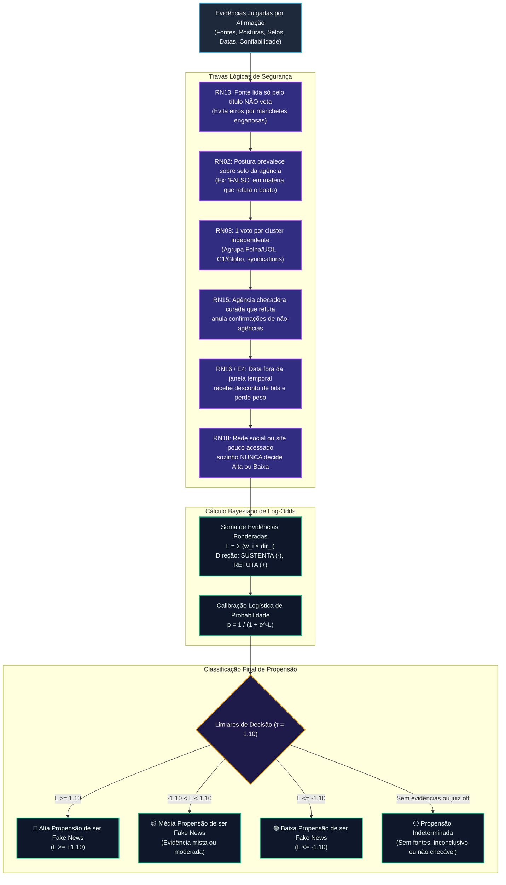

# Checa AI — Desenho do Fluxo e Arquitetura da Aplicação

| Metadado | Detalhe |
|---|---|
| **Versão** | 1.0 (Entregável do Desafio First Challenge) |
| **Data de Emissão** | 15/10/2026 |
| **Repositório** | `thiago-cg/Checa-AI` |
| **Branch** | `feat/entrega-fluxo-aplicacao` |
| **Código de Referência** | `factcheck_mvp/` (pipeline, agentes, modelos e decisão) |
| **Autoria / Equipe** | Eliane Orlandin do Carmo, Thiago Correia Gonzaga, Maria Eduarda Denis Duarte Marques, Guilherme Silva Dutra, Gabriella Oliveira de Souza Dias, Daltro Oliveira Vinuto |

---

## 1. Visão Geral e Princípios Arquiteturais

O **Checa AI** (CrossCheckBR) é um assistente inteligente de verificação de fatos em português brasileiro desenvolvido para apoiar a pessoa usuária a distinguir fatos, evidências e opiniões no ecossistema de informação digital. 

A arquitetura do sistema foi projetada sob quatro pilares inegociáveis:

1. **Propensão em vez de Veredito (RN01, RF12, RNF02):** A inteligência artificial nunca afirma categoricamente que uma mensagem "é verdadeira" ou "é mentira". A conclusão é expressa como uma **propensão** (*baixa*, *média*, *alta* ou *indeterminada*) a se tratar de desinformação, acompanhada de evidências auditáveis.
2. **Fortalecimento do Pensamento Crítico (RF14, Guiding Questions):** Cada análise é encerrada com 3 perguntas-guia metodológicas e a declaração de que o relatório não substitui o juízo autônomo do cidadão.
3. **Transparência Radical e Rastreabilidade (RF11, RNF01, RNF03):** 100% das consultas geram um recibo discriminando etapas executadas, fontes lidas na íntegra versus fontes parciais, limitações técnicas declaradas e traces auditáveis em `runs/<run_id>/trace.jsonl`.
4. **Desacoplamento e Resiliência (RNF05, RNF08):** Separação estrita entre os canais de entrada (Telegram, Web, API, CLI), o orquestrador do pipeline, os provedores de inferência (OpenRouter, LLM Local, Heurísticas), o motor de busca (SerpAPI) e o núcleo determinístico de decisão bayesiana.

---

## 2. Macro-Fluxo da Aplicação (Visão Geral de Alto Nível)

O diagrama abaixo ilustra o ciclo de vida completo de uma consulta, desde a entrada pelo usuário até a entrega da resposta fundamentada:

```mermaid
flowchart TD
    %% Estilos
    classDef startNode fill:#1E293B,stroke:#475569,stroke-width:2px,color:#F8FAFC;
    classDef processNode fill:#0F172A,stroke:#38BDF8,stroke-width:1.5px,color:#F1F5F9;
    classDef decisionNode fill:#1E1B4B,stroke:#818CF8,stroke-width:2px,color:#EEF2FF;
    classDef gateNode fill:#312E81,stroke:#A855F7,stroke-width:2px,color:#FAF5FF;
    classDef parallelNode fill:#064E3B,stroke:#34D399,stroke-width:1.5px,color:#ECFDF5;
    classDef endNode fill:#1E293B,stroke:#10B981,stroke-width:2px,color:#ECFDF5;

    User([👤 Usuário: Envia Texto, Título ou Link]):::startNode
    
    subgraph S1["1. Recepção e Interfaces"]
        Canal{Canal de Entrada}:::decisionNode
        TgBot["🤖 Robô Telegram\n(telegram_bot.py)"]:::processNode
        WebUI["🌐 Interface Web\n(GET / na api.py)"]:::processNode
        RestAPI["⚡ API REST\n(POST /checar)"]:::processNode
        CLI["💻 Linha de Comando\n(cli.py)"]:::processNode
    end

    User --> Canal
    Canal -->|Telegram| TgBot
    Canal -->|Navegador| WebUI
    Canal -->|Integração| RestAPI
    Canal -->|Terminal| CLI

    subgraph S2["2. Pré-processamento e Triagem"]
        ClassificaInput["Classificação da Entrada\n(Texto | Título | Link)"]:::processNode
        TriagemMidia{"É Mídia (Áudio/Vídeo/Img)?"}:::decisionNode
        OrientacaoMidia["⚠️ Recusa com Orientação\n(Dica de busca reversa / colar texto)"]:::processNode
        LeituraLink{"É Link de Portal Confiável?"}:::decisionNode
        PedeTexto["⚠️ Pede texto da notícia\n(Evita paywall/bloqueio)"]:::processNode
        SinaisPreliminares["Marcadores Temporais (E4)\ne Detecção Heurística\n(Rumor / Opinião / Vago)"]:::processNode
    end

    TgBot & WebUI & RestAPI & CLI --> ClassificaInput
    ClassificaInput --> TriagemMidia
    TriagemMidia -->|Sim| OrientacaoMidia --> EndUserEarly([Fim da Consulta]):::endNode
    TriagemMidia -->|Não| LeituraLink
    LeituraLink -->|Link Ilegível/Fora Catálogo| PedeTexto --> EndUserEarly
    LeituraLink -->|Link Válido ou Texto/Título| SinaisPreliminares

    subgraph S3["3. Decomposição Factual"]
        ExtracaoAfirmacoes["Extração de Afirmações Fatuais\n(LLM com fallback determinístico)\nRemove 'me mandaram', preserva falas"]:::processNode
        TemAfirmacao{"Afirmações > 0?"}:::decisionNode
        SemFato["Propensão INDETERMINADA\n(Texto sem alegação factual)"]:::processNode
    end

    SinaisPreliminares --> ExtracaoAfirmacoes
    ExtracaoAfirmacoes --> TemAfirmacao
    TemAfirmacao -->|Não| SemFato --> EndUserEarly
    TemAfirmacao -->|Sim| Bifurcacao

    Bifurcacao((⚡)):::gateNode

    subgraph S4["4. Análise de Estilo (Paralela e Isolada — RN11)"]
        EstiloBERT["BERTimbau v6 (Calibrado Platt)\nPiso: >= 80 palavras (RN04)"]:::parallelNode
        EstiloPadroes["Detecção de Padrões Sensacionalistas\n(Urgência, Alarmismo, Fonte Vaga)"]:::parallelNode
        SinaisEstilo["Sinais de Estilo Textual\n(NÃO afetam o nível de propensão)"]:::parallelNode
        EstiloBERT & EstiloPadroes --> SinaisEstilo
    end

    subgraph S5["5. Camada de Evidências — Base Primeiro (Gate E1)"]
        BuscaBase["Busca na Base Histórica de Checagens\n(21.976 checagens de 9 agências +\nGoogle Fact Check Tools API)"]:::processNode
        FaseBase["Julgamento 1:1 das Peças da Base\n(Leitura integral + Juiz LLM)"]:::processNode
        GateE1{"Checagem Aplicável na Base?\n(Mesmo fato + Citação OK +\nSelo com direção + Data compatível)"}:::gateNode
    end

    Bifurcacao -->|Branch Estilo| EstiloBERT
    Bifurcacao -->|Branch Factual| BuscaBase
    BuscaBase --> FaseBase --> GateE1

    subgraph S6["6. Camada de Evidências — Busca Aberta Web (Fallback)"]
        SerpAPI["Busca Aberta na Web (SerpAPI)\nConsultas segmentadas por afirmação"]:::processNode
        AgenteReAct["Agente ReAct de Busca\n(Planejador + Ondas Extras pós-juiz)"]:::processNode
        SerpAPI --> AgenteReAct
    end

    GateE1 -->|NÃO: Base não resolve| SerpAPI
    GateE1 -->|SIM: Base resolveu| PulaWeb["⚡ Pula Busca Web\n(Economia de cota e 30-40s)"]:::gateNode

    subgraph S7["7. Deduplicação, Leitura e Juiz"]
        DedupeCanonica["Deduplicação Canônica de URLs\nFiltro de homepages, seções e redes sociais"]:::processNode
        DeepCrawl["Deep Crawl (Corpo Completo)\ncurl_cffi + Extração de ClaimReview"]:::processNode
        ClustersIndependencia["Agrupamento em Clusters Independentes\n(Mesmo grupo econômico / Mesma agência / Redação idêntica)"]:::processNode
        JuizLLM["Avaliador 1:1 & Juiz LLM\n(SUSTENTA / REFUTA / RELATA / NÃO TRATA)\ncom Verificação Rígida de Citação"]:::processNode
    end

    PulaWeb --> ClustersIndependencia
    AgenteReAct --> DedupeCanonica --> DeepCrawl --> ClustersIndependencia
    ClustersIndependencia --> JuizLLM

    subgraph S8["8. Síntese e Decisão Bayesiana"]
        Autoconsistencia["Autoconsistência / Crítico\n(Rejulgamento se 1 voto definir nível)"]:::processNode
        MotorDecisao["Motor de Decisão Bayesiano (decisao.py)\nLog-Odds simétrico com Dirichlet Prior\n1 voto por cluster | Travas de Data E4"]:::processNode
        CalibracaoPropensao["Cálculo da Propensão\n(Baixa | Média | Alta | Indeterminada)"]:::processNode
    end

    JuizLLM --> Autoconsistencia --> MotorDecisao --> CalibracaoPropensao

    subgraph S9["9. Agregação e Entrega ao Cidadão"]
        FormataRelatorio["Montagem do Relatório Neutro (RNF02)\n- Nível de propensão com justificativa\n- Fontes com confiabilidade Tranco\n- Selos com atribuição explícita\n- 3 Perguntas-Guia de reflexão (RNF14)\n- Recibo de etapas e limitações"]:::processNode
        AuditRuns["Auditoria e Telemetria\n(Gravação em runs/<id>/trace.jsonl)"]:::processNode
        Feedback["Feedback do Usuário\n(Botões 👍 / 👎 para feedback.jsonl)"]:::processNode
        Retorno([📱 Entrega da Resposta ao Usuário]):::endNode
    end

    CalibracaoPropensao --> FormataRelatorio
    SinaisEstilo --> FormataRelatorio
    FormataRelatorio --> AuditRuns --> Retorno
    Retorno -.-> Feedback
```

---

## 3. Diagrama de Sequência de Ponta a Ponta

O diagrama a seguir detalha a comunicação temporal síncrona e assíncrona entre os componentes internos durante o processamento de uma notícia:

```mermaid
sequenceDiagram
    autonumber
    actor U as Usuário
    participant C as Canal (Telegram / API)
    participant P as Pipeline (Orquestrador)
    participant A as Extrator Afirmações
    participant B as Base Histórica (Índice + API)
    participant G as Gate E1 (Aplicabilidade)
    participant W as Busca Web (SerpAPI / Agente)
    participant D as Crawler (curl_cffi)
    participant J as Juiz LLM (OpenRouter / Local)
    participant M as Modelo Estilo (BERTimbau v6)
    participant DEC as Motor de Decisão (Bayesiano)
    participant T as Telemetria (trace.jsonl)

    U->>C: Envia mensagem (texto/link)
    C->>P: executar(EntradaConsulta)
    P->>T: iniciar_run(metadados, config, sal)
    
    rect rgb(30, 41, 59)
        note over P,A: Fase 1: Pré-processamento e Afirmações
        P->>P: Detecta marcas de rumor, opinião, vago e temporalidade E4
        P->>A: extrair_afirmacoes(texto)
        A-->>P: Lista de Afirmações [polaridade, núcleo, consulta]
    end

    par Investigação Factual vs Análise de Estilo
        rect rgb(15, 23, 42)
            note over P,B: Fase 2: Base Primeiro (E1)
            P->>B: buscar_checagens(núcleo) [Índice BM25 + Google FactCheck]
            B-->>P: Candidatos da Base (agência, selo, data_pub, url)
            P->>D: _ler(candidatos_base)
            D-->>P: Corpo das checagens
            P->>J: _julgar(afirmações, corpo_base)
            J-->>P: Posturas (SUSTENTA / REFUTA / RELATA) + Citações
            P->>G: eh_aplicavel(julgamento, data_pub, janela_temporal)
            alt Checagem Aplicável Encontrada na Base
                G-->>P: True (Pula busca web aberta)
            else Sem checagem aplicável
                G-->>P: False (Aciona SerpAPI aberta)
                P->>W: _buscar_web(afirmações)
                W-->>P: Resultados de Busca Web (URLs)
                P->>D: _ler(URLs candidatas)
                D-->>P: Conteúdo das páginas (HTML -> texto limpo + JSON-LD)
                P->>J: _julgar(afirmações, corpo_web)
                J-->>P: Posturas e Citações verificadas
            end
        end
    and Análise de Estilo Paralela
        rect rgb(6, 78, 59)
            note over P,M: Fase 3: Estilo Textual (RN11)
            alt Texto >= 80 palavras
                P->>M: predizer(texto)
                M-->>P: P(fake) calibrado Platt
            else Texto < 80 palavras
                P-->>P: Etapa estilo pulada (RN04)
            end
            P->>P: Avalia padrões de urgência, alarmismo e fontes vagas
        end
    end

    rect rgb(30, 27, 75)
        note over P,DEC: Fase 4: Agrupamento e Decisão
        P->>P: Agrupa peças em clusters independentes (mesmo grupo/agência)
        P->>DEC: decidir(Evidencias)
        DEC->>DEC: Aplica travas RN02, RN03, RN13, RN15, RN16, RN18
        DEC->>DEC: Calcula Log-Odds simétrico com Dirichlet Prior
        DEC-->>P: ResultadoDecisao(nível, log_odds, prob, motivo)
    end

    rect rgb(20, 30, 50)
        note over P,U: Fase 5: Conclusão, Auditoria e Entrega
        P->>P: Formata relatório com neutralidade e 3 perguntas-guia
        P->>T: finalizar_run(relatorio)
        P-->>C: RelatorioChecagem
        C-->>U: Mensagem formatada com propensão, fontes e perguntas-guia
        U-->>C: Clique opcional 👍 / 👎 (Feedback anônimo)
        C->>P: registrar_feedback(voto)
    end
```

---

## 4. O Motor de Decisão Bayesiano e as Regras de Negócio

O núcleo de agregação (`factcheck_mvp/decisao.py`) é **100% determinístico e auditável**: a decisão final não é delegada a um modelo de linguagem, garantindo imunidade a alucinações e previsibilidade matemática (RNF01).

### 4.1. Tabela de Ponderação e Confiabilidade de Fontes

| Categoria da Fonte | Critério de Classificação | Peso Típico ($w$) | Papel na Decisão |
|---|---|---|---|
| **Agência de Checagem Curada** | Portais cadastrados (Lupa, Aos Fatos, Boatos.org, E-Farsas, Estadão Verifica, Fato ou Fake, Comprova) | Alto ($\approx 1.0$ a $1.2$) | Refutação pesa fortemente; anula confirmações leigas (RN15). |
| **Veículo Geral de Grande Audiência** | Top ranking da lista Tranco (G1, UOL, Folha, Estadão, CNN Brasil, BBC Brasil) | Médio-Alto ($\approx 0.8$ a $1.0$) | Confirmações ou contestações consistentes orientam a propensão. |
| **Portal Regional / Especializado** | Tranco mediano ou portal jornalístico independente verificado | Médio ($\approx 0.6$) | Contribui para o cluster sem monopólio de decisão. |
| **Site Pouco Acessado / Desconhecido** | Fora do ranking Tranco principal | Baixo ($\approx 0.3$) | Não possui poder decisório isolado (RN18). |
| **Rede Social / Plataforma UGC** | YouTube, TikTok, X, Facebook, Instagram, Reddit | Muito Baixo ($\le 0.2$) | Nunca leva a propensão a Alta ou Baixa sozinha (RN18). |

---

## 5. Mapeamento Detalhado das 12 Etapas da Aplicação

| # | Etapa do Pipeline | Módulo Principal | Entradas | Processamento | Saídas | Requisitos |
|---|---|---|---|---|---|---|
| **01** | **Recepção e Classificação** | `telegram_bot.py` / `api.py` | Texto, título ou URL | Classifica tamanho, formato e tipo de entrada. Bloqueia mídias com orientação pedagógica. | `EntradaConsulta` tipada | RF01, RF02, RF03 |
| **02** | **Triagem Heurística** | `pipeline.py` / `aplicabilidade.py` | Texto bruto da entrada | Detecta marcas de rumor ("ouvi dizer"), opinião/sátira, comparativo vago sem indicador e marcas temporais ("hoje", "ontem"). | `Marcadores`, `Limitações` | RF19, RF20 |
| **03** | **Extração de Afirmações** | `afirmacoes.py` | Texto limpo | LLM ou regex estruturado isola as alegações fatuais verificáveis, removendo introduções e preservando o locutor. | Lista de `Afirmacao` | RF04, RF05 |
| **04** | **Base Primeiro (Gate E1)** | `indice.py` / `factcheck_api.py` | Núcleo da afirmação | Consulta índice BM25 (21.976 checagens de 9 agências) e Google Fact Check Tools API. | Peças da Base | RF04, RF17 |
| **05** | **Julgamento da Base** | `pipeline.py` (`_fase_base`) | Peças da base + Afirmações | Deep crawl dos links da base, juiz LLM 1:1 e teste de aplicabilidade (fato idêntico, citação OK, data compatível). | `houve_aplicavel` (True/False) | RF17, RN14, RN16 |
| **06** | **Busca Web Aberta** | `serpapi_layer.py` / `agente.py` | Afirmações não resolvidas | Se a base não resolveu, constrói queries direcionadas e busca na web via SerpAPI (Google BR). Agente ReAct opcional. | Peças Web | RF05 |
| **07** | **Dedupe e Filtragem** | `corroboracao.py` / `catalogo.py` | URLs de base e web | Normalização canônica, descarte de homepages, páginas de tag/categoria e sites com login forçado. | Peças Únicas e Catalogadas | RF06, RN05, RN06 |
| **08** | **Deep Crawl & Extração** | `aprofundar.py` / `extracao.py` | URLs filtradas | Download com `curl_cffi` (impersonando navegador), extração de texto principal e metadados JSON-LD `ClaimReview`. | Corpos de Matéria e Selos | RF05, RF07 |
| **09** | **Clusters de Independência** | `corroboracao.py` | Peças lidas | Agrupa veículos do mesmo grupo editorial e matérias com texto idêntico. Identifica divergências entre fontes. | Clusters Independentes | RF06, RN03 |
| **10** | **Juiz LLM 1:1 com Citação** | `juiz_llm.py` / `avaliador.py` | Par (Afirmação, Matéria) | Classifica postura (SUSTENTA, REFUTA, RELATA, NÃO TRATA) exigindo cópia exata de trecho comprobatório na página. | Postura e Citação Validada | RF13, RNF07 |
| **11** | **Análise de Estilo (Paralela)** | `modelo_fake.py` / `padroes_llm.py` | Texto integral da entrada | BERTimbau calibrado (para $\ge 80$ palavras) e detector de gatilhos emocionais/urgência. Isolada do veredito. | `SinaisEstilo` (não votam) | RF08, RF09, RF10, RN11 |
| **12** | **Agregação e Relatório** | `decisao.py` / `agregador.py` | Evidências e Sinais | Cálculo bayesiano determinístico, enquadramento na propensão neutra, 3 perguntas-guia e recibo de etapas. | `RelatorioChecagem` | RF11, RF12, RF14, RNF01 |

---

## 6. Arquitetura de Provedores e Fallbacks em Cascata

Para cumprir com o requisito de alta confiabilidade (**RNF08**), nenhuma falha de provedor externo (SerpAPI, APIs de LLM ou portais jornalísticos) derruba a aplicação. A tabela abaixo sintetiza os planos de contingência arquiteturais:

```mermaid
graph TD
    classDef mainNode fill:#1E293B,stroke:#38BDF8,stroke-width:1.5px,color:#F8FAFC;
    classDef fallbackNode fill:#3B0764,stroke:#C084FC,stroke-width:1.5px,color:#FAF5FF;
    classDef safeNode fill:#064E3B,stroke:#34D399,stroke-width:1.5px,color:#ECFDF5;

    subgraph LLM["Cascata de Modelos de Linguagem (LLM)"]
        L1["1. OpenRouter API\n(deepseek/deepseek-chat ou gemini-flash)"]:::mainNode
        L2["2. Servidor Local Unsloth Studio\n(Qwen3.8-27B / LFM2.5-8B local)"]:::fallbackNode
        L3["3. Regras Léxicas e Heurísticas Fixas\n(Regex determinístico sem inteligência artificial)"]:::safeNode
        L1 -->|Chave esgotada / Timeout / 429| L2
        L2 -->|Servidor local offline / Modelo descarregado| L3
    end

    subgraph Busca["Busca na Web (SerpAPI)"]
        S1["1. Busca Aberta SerpAPI (Google BR)"]:::mainNode
        S2["2. Degradação Graciosa: Segue com Base Histórica\nDeclara limitação no recibo: 'Busca web indisponível'"]:::safeNode
        S1 -->|Cota diária excedida / Falha HTTP| S2
    end

    subgraph Leitura["Leitura de Links e Páginas Web"]
        C1["1. curl_cffi com Impersonate de Navegador"]:::mainNode
        C2["2. requests padrão com headers customizados"]:::fallbackNode
        C3["3. Fonte vira 'Só Manchete' (não vota, RN13)"]:::safeNode
        C1 -->|Bloqueio Cloudflare / Antibot| C2
        C2 -->|Paywall rígido / Falha total de download| C3
    end
```

---

## 7. Observabilidade, Auditoria e Telemetria

Toda consulta executada pelo motor do Checa AI gera um rastro estruturado em formato JSON Lines (`runs/<run_id>/trace.jsonl`), permitindo reprodutibilidade forense, identificação de gargalos de tempo e custos de inferência:

1. **Redação Automática de Segredos (RNF07):** Chaves de API (`SERPAPI_KEY`, `OPENROUTER_API_KEY`, tokens do Telegram) são automaticamente redigidas antes da gravação do log.
2. **Replay Determinístico (`replay.py`):** Possibilidade de reexecutar consultas idênticas de forma 100% offline utilizando cassetes gravados de requisições HTTP e LLM, permitindo rodar suítes de testes sem consumir cotas pagas.
3. **Registro de Avaliação da Pessoa Usuária (RF16):** Os botões de feedback interativo (👍 / 👎) registram métricas anônimas em `feedback.jsonl` sem guardar identificadores pessoais ou dados sensíveis.

---

## 8. Conclusão e Próximos Passos

O desenho de fluxo do Checa AI materializa com rigor as diretrizes pedagógicas e técnicas do desafio: substitui o conceito ultrapassado de "árbitro da verdade" por um **assistente metodológico e transparente de apuração**.

* **Documentos Relacionados:**
  - Requisitos do Sistema: [`entrega/requisitos/requisitos.md`](../requisitos/requisitos.md)
  - Organização da Equipe e Papéis: [`entrega/organizacao/organizacao.md`](../organizacao/organizacao.md)
  - Análise Exploratória de Dados: [`entrega/EDA/README.md`](../EDA/README.md)
  - Visualizador Interativo do Fluxo: [`entrega/fluxo_aplicacao/fluxo_aplicacao.html`](fluxo_aplicacao.html)
